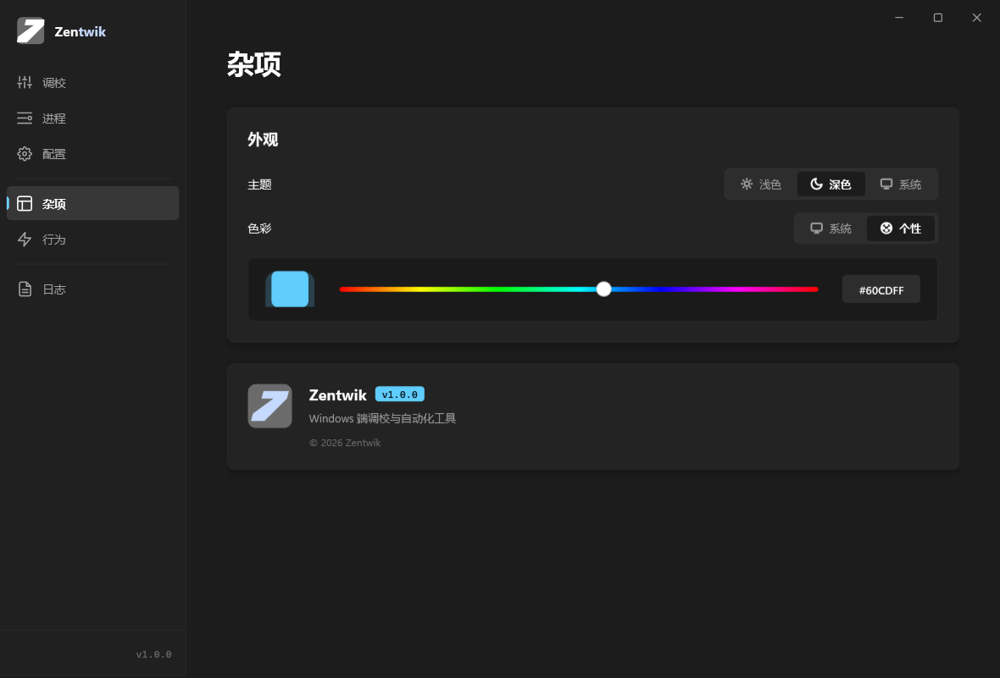
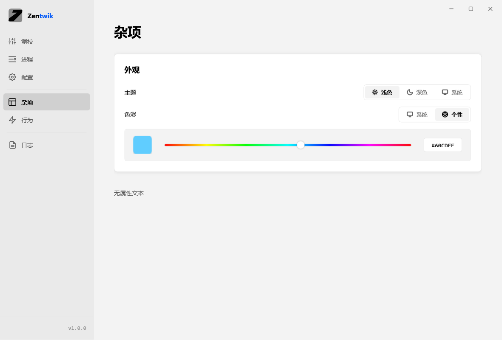
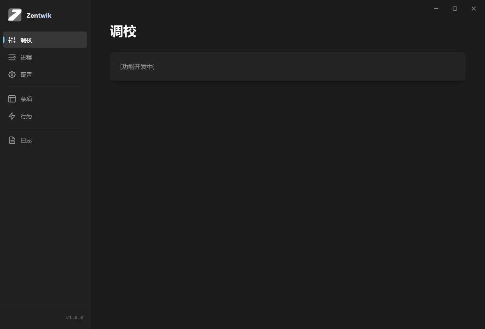
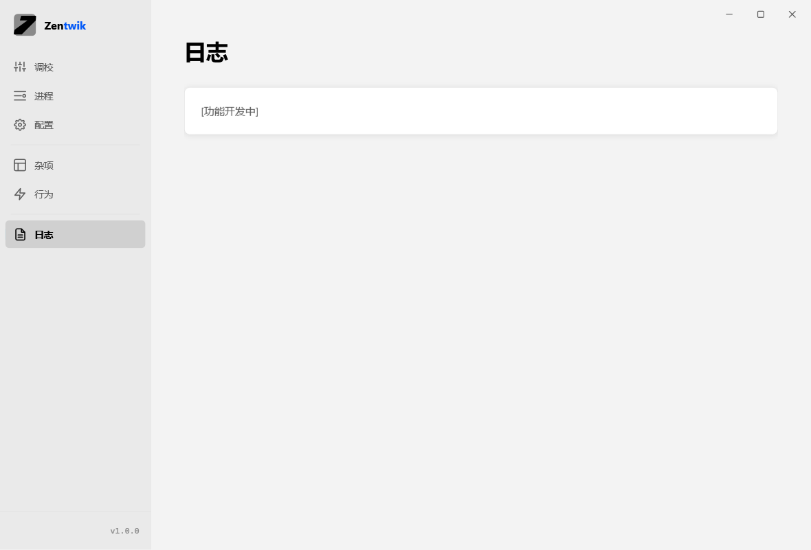

# Zentwik 主题 / 外壳重构 Demo

参考 HTML（`deepseek_html_20261103_05531e (1).html`）的 WPF 转写实现。

## 截图

| 深色 · 杂项 | 浅色 · 杂项 |
|---|---|
|  |  |

| 深色 · 调校 | 浅色 · 日志 |
|---|---|
|  |  |

## 运行

```bash
dotnet run                                # 启动窗口
dotnet run -- --selftest                 # 颜色算法断言（与参考 HTML 的 JS 逐字节对齐）
dotnet run -- --itest                    # 集成断言（主题切换 / 改色 / 双向绑定）
dotnet run -- --screenshot out.png --theme=light   # 离屏截图
```

## 架构

```
MainWindow.xaml(.cs)      外壳层 —— Code-Behind
                          · 窗口拖拽（DragMove）
                          · 窗口控制按钮（最小化 / 最大化 / 关闭）
                          · 左侧导航路由（ContentControl 换 UserControl）
                          · WM_GETMINMAXINFO 修正最大化工作区

Views/SettingsView.xaml   业务层 —— MVVM
ViewModels/               SettingsViewModel：状态切换与颜色计算全在这里

Services/
  AppThemeService         主题引擎：字典热切换 / 强调色改色 / 品牌色重算
  SystemTheme             系统明暗与系统强调色（注册表）
  SystemEventsBridge      WM_SETTINGCHANGE 钩子（系统主题变化监听）
  ColorMath               HSL ↔ RGB + 品牌色衍生
  IntegrationTest         集成自检
Themes/
  Tokens.Dark.xaml        深色令牌
  Tokens.Light.xaml       浅色令牌（键集合与深色严格一致）
  Accent.xaml             强调色字典（画刷实例由代码注入，见下）
  Controls.xaml           分段控件 / 彩虹滑块 / 导航项 / 窗口按钮样式
```

## 关键实现决策

### 1. 窗口：AllowsTransparency=False + WindowChrome 圆角

`AllowsTransparency="True"` 会让 WPF 退回 System DPI 感知，跨显示器时界面按位图拉伸、
文字发虚，且**运行期无任何 API 能补救**。改用 `WindowChrome.CornerRadius` 做圆角，
视觉等价但保留 Per-Monitor V2 硬件缩放（见 `app.manifest`）。

`CaptionHeight="0"` —— CaptionHeight 一旦大于 0，标题区交给 OS 做原生拖拽，
WPF 自己的 `MouseLeftButtonDown` 未必还触发。拖拽完全交给 Code-Behind 的 `DragMove()`。

### 2. 强调色：替换画刷实例，而非改 `.Color`

`ResourceDictionary` 会对放入的 `Freezable` **自动冻结**，冻结后设 `.Color` 抛
`InvalidOperationException`。而强调色必须随滑块反复改色。

解法：改色时**用新画刷实例替换字典项**。实测这既避开冻结，又能触发
`DynamicResource` 绑定立即刷新（红→绿→黄全部生效）。

> ⚠️ XAML 里定义的画刷必然被冻结 —— 所以 `Accent.xaml` 只留文档，画刷实例由
> `AppThemeService` 在代码里 new 出来注入。

### 3. 初始化顺序：字典合并必须早于 `InitializeComponent`

`MainWindow.xaml` 用 `{StaticResource NavItemStyle}` 引用样式，XAML 解析时就会去
`Application.Resources` 找。字典合并若晚于 `InitializeComponent`，运行时抛
「找不到资源 NavItemStyle」。

系统主题监听需要窗口句柄，必须等 `OnSourceInitialized` 之后 —— 故拆成
`Initialize()`（合并字典）与 `AttachWindow()`（挂钩子）两步。

### 4. TwoWay 绑定的初始化回写

WPF 的 TwoWay 绑定在视图加载时会把源值回写到目标（`Slider.Value`），Slider 随即
触发 `ValueChanged` → 回写 `HueValue` → 走进 setter。若不拦截，初始强调色
`#60CDFF` 会被 `hsl(198.87, 85, 65)` = `#5AC4F2` 覆盖，造成「预览色块」与
「HEX 输入框」显示两种不同的颜色。

解法：`SettingsViewModel._initialized` 标志 + 视图 `Loaded` 事件调用
`OnViewLoaded()` 解除保护。

### 5. 滑块与颜色的方向

与参考 HTML 的 `applyAccentColor` 一致：

- 滑块拖动 → 生成 `hsl(h, 85%, 65%)` → 写回 HEX 输入框 → 写回强调色
- HEX 提交 → 解析 → 反向更新滑块 H 值 → 写回强调色

渐变轨道两侧留 `Margin="9,0"`（= Thumb 18px 的一半），使渐变区间与 Thumb 中心
行程严格重合 —— 否则两端会出现「Value=0 时 Thumb 压在渐变中段」的错位。

实测像素级验证：滑块圆点位于轨道 **55.15%**，期望 55.24%（H=198.87），偏差 −0.09%。

### 6. 系统强调色的注册表来源

两个来源，优先第一个：

| 键 | 值 | 说明 |
|---|---|---|
| `HKCU\...\Explorer\Accent\AccentPalette` | byte[32] | Windows 11 权威来源，每 4 字节一组 B,G,R,A |
| `HKCU\...\DWM\AccentColor` | REG_DWORD | COLORREF 格式（0x00BBGGRR，**注意是 BGR**） |

> ⚠️ `Explorer\Accent` 下**没有** `AccentColor` 这个值（只有 `AccentPalette` /
> `StartColorMenu` / `AccentColorMenu`）。误读成 `AccentColor` 会永远读不到值、
> 静默退回默认蓝。本机实测 `DWM\AccentColor` = `0xFFC3B700` → RGB(0,183,195)。

### 7. WPF 与 CSS 的属性差异

| CSS | WPF | 说明 |
|---|---|---|
| `stroke-linecap: round` | `StrokeStartLineCap` + `StrokeEndLineCap` | `Shape` **没有** `StrokeLineCap` 属性 |
| `letter-spacing: 0.5px` | `Typography.Kerning` | WPF **没有** `LetterSpacing` 可绑定属性 |
| `skewX(-15deg)` | `SkewTransform.AngleX` / `AngleY` | `Angle` 是 `RotateTransform` 的 |

## 数值基准

颜色算法的期望值不是拍脑袋写的，而是把参考 HTML 的 `hslToHex` / `hexToHsl` /
`applyAccentColor` 三个 JS 函数原样搬到 C# 侧复算出来的，两边必须逐字节相同。

| 项 | 值 |
|---|---|
| `#60CDFF` 的 HSL | H=198.87, S=100, L=68.82 |
| `hsl(198, 85%, 65%)` | `#5AC4F2` |
| 品牌色（深色） | `#C6DAFF`（H+20°、S+15、L+20） |
| 品牌色（浅色） | `#0058F9`（H+20°、S+15、L−20） |

> 注：HTML 里 CSS 声明的 `--brand-accent: #A4ECFF` 只是**静态初始值**，
> 首次调用 `applyAccentColor()` 后会被覆盖为 `#C6DAFF`。

## 待办

- 托盘图标（48×48 版本已放入 `Assets/ZentwikTray.ico`，未接入）
- 其余五个导航页（调校 / 进程 / 配置 / 行为 / 日志）目前是占位视图
- 彩虹面板的展开动画（当前用 `Visibility` 切换，未做高度插值）
